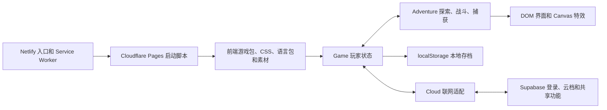

# Poke’Catch 架构调研与本地复刻准备

调研日期：2026-11-04。范围是原站公开发布的 HTML、JavaScript 和作者公开说明。本地工作区在调研时没有原项目源码。本文的代码符号来自线上构建产物，可用于定位，但原始目录结构和服务端源码仍待确认。

## 1. 系统怎么分工

| 层 | 已核实的实现 | 可定位的证据 |
| --- | --- | --- |
| 发布 | Netlify 返回一个很小的 HTML，注册 `/sw.js` 后加载 Cloudflare Pages 的 `boot.js`。启动脚本提供页面骨架并引用游戏 JS、CSS、Supabase 客户端和语言包。入口与资源分开部署，浏览器存档仍跟随入口域名。 | [入口 HTML](https://pokecatch-online.netlify.app/)、[boot.js](https://pokecatch-online.pages.dev/boot.js) |
| 数据与状态 | 物种数据直接打进 JS 包，包含属性、基础能力、捕获率和按等级学习的招式。配置和运行态分开，`Game.S` 暴露当前状态，`Game` 提供存读档、经验、图鉴、队伍等接口。 | [游戏包](https://pokecatch-online.pages.dev/bundle/app.5f011bb067.js)，搜索 `t.POKEDEX`、`t.CONFIG`、`t.Game=` |
| 表现 | HTML 骨架含顶部栏和各类面板。游戏包有 DOM UI 模块，也使用 Canvas 2D 处理图像和特效。官网鸣谢 Pokémon Showdown 与 PokéSprite 的精灵素材。 | [启动脚本](https://pokecatch-online.pages.dev/boot.js)、[游戏包](https://pokecatch-online.pages.dev/bundle/app.5f011bb067.js)，搜索 `t.UI=`、`getContext("2d")`、`FX_MOVES` |
| 联网 | `Cloud` 使用 Supabase OAuth 登录，前端有 Discord 登录配置，首页也提供 Google 登录。好友、市场、交易、突袭榜等功能有独立 RPC。 | [游戏包](https://pokecatch-online.pages.dev/bundle/app.5f011bb067.js)，搜索 `t.Cloud=`、`signInWithOAuth`、`trade_accept`、`mkt_buy`、`raid_board` |

## 2. 主循环和状态流

1. **进入冒险。** 玩家带着队伍进入章节。前端的 `Adventure` 对外提供 `buildChapter`、`setChapter`、`step` 和 `tick`，以及遭遇池、道具概率和战斗相关接口。配置定义 1×、2×、4×，其中 4× 还有独立节奏配置，复刻时可以自行确定视觉节奏与模拟速度的关系。
2. **遇敌并自动战斗。** 作者说明宝可梦根据对手选择招式，区分物理和特殊攻击。代码包中能定位到 `effectiveness`、`winChance`、`aliveTeam` 等入口。公开包包含客户端规则与数据，足以确认普通冒险有浏览器端模拟。本文没有完整还原所有招式的选择权重、回合流程和胜负公式。[作者介绍与问答](https://www.reddit.com/r/pokemonfr/comments/1x94jmr/pokecatch_besoin_de_vos_avis_jeu_navigateur/)
3. **战后捕获与入库。** 作者描述打赢野生宝可梦后会尝试自动捕获。代码里 `Adventure.catchProb` 有按物种 `captureRate`、配置倍率、捕获增益和上限计算的路径，也有特殊捕获率分支。游戏包可见 `Game.receive` 接收带 `uid`、物种 `id`、等级、经验和异色标记的个体。队伍与仓库读取接口分别是 `teamMons` 和 `pcMons`。
4. **结算与继续。** `Game` 提供经验、升级、图鉴登记和存档接口，界面呈现状态和结果。原作有天气、昼夜、道馆、寄养、异色和突袭等扩展。2026-10-18 的发布帖可用来核对玩法来源，具体数值以对应构建版本为准。[发布帖](https://www.reddit.com/r/pokemonfr/comments/1x94jmr/pokecatch_besoin_de_vos_avis_jeu_navigateur/)

本节代码定位均可在[游戏包](https://pokecatch-online.pages.dev/bundle/app.5f011bb067.js)搜索 `t.Adventure=`、`catchProb` 和 `t.Game=`。

## 3. 存档、离线追赶和联机边界

- **本地档。** `Game.load` 读取 `localStorage` 中的 `gachamon-save-v1`，将解析结果合入默认状态，再做数据整理和旧版本迁移。解析出错时回到默认状态。包中还有 `TabLock`，使用存储事件处理多标签页的持有权。[游戏包](https://pokecatch-online.pages.dev/bundle/app.5f011bb067.js)
- **离线收益。** 恢复时按游戏时间与上次记录的时间差计算，受 `OFFLINE_MAX_MS` 限制，该构建的配置为 8 小时。时长过短或没有队伍会提前返回。通过 `Adventure.offline` 生成待执行结果，追赶期间用 `holdSave` 协调保存。配置另有离线经验倍率和等级增量上限。这个设计可以在回来时批量结算，无需后台维持网页计时器。[游戏包，搜索 `OFFLINE_MAX_MS`、`t.CatchUp=`](https://pokecatch-online.pages.dev/bundle/app.5f011bb067.js)
- **云档。** 客户端调用 `cloud_head`、`cloud_load`。可见的一条写入路径用 `user_id` 和已有 `updated_at` 作为更新条件，另有带基准版本的 `save_put` 路径。这个接口形状支持客户端检查覆盖冲突。实际数据库约束和所有冲突分支需服务端代码才能确认。[游戏包](https://pokecatch-online.pages.dev/bundle/app.5f011bb067.js)
- **共享玩法。** 前端以 `trade_accept`、`mkt_buy`、`raid_submit_many` 等函数提交业务操作。仅从接口名和参数可确定调用边界。交易是否原子执行、如何授权、突袭成绩由谁校验、部署拓扑与数据库表结构，均缺少可验证的服务端实现。[游戏包](https://pokecatch-online.pages.dev/bundle/app.5f011bb067.js)

## 4. 用 GPT 做本地原型

以下是复刻建议。首版采用静态 HTML、CSS、原生 JavaScript 模块和本地 HTTP 开发服务。用原创名字与占位图，准备 3 种属性、6 个物种、2 条路线和 1 个道馆。把物种和招式数据独立出来，之后增加内容时可以沿用同一套战斗代码。

| 实现顺序 | 交给 GPT 的工作 | 验收场景 |
| --- | --- | --- |
| 1. 规则 | 建立物种表、招式表和路线权重表。实现遇敌、属性克制、回合结算、捕获和入队或入仓。规则函数接收随机数源和步数，输出新状态与事件。 | 固定随机种子能重复同一场战斗。队伍满员后，捕获个体只在仓库出现一次。败北不触发捕获。 |
| 2. 网页 | 提供选初始伙伴、选路线、战斗日志、队伍、仓库和速度按钮。用同一个调度器驱动规则，并从事件更新界面。 | 新玩家从首页即可完成一次捕获。切换速度或路线后只有一个调度器在跑。 |
| 3. 本地存档 | 用版本化 JSON 存储伙伴、路线、图鉴和最后保存时间。定义损坏存档的提示及恢复路径。存档键使用自己的项目名。 | 刷新后恢复队伍与进度。损坏档提示可恢复。重新开局有清楚的操作入口。 |
| 4. 离线和成长 | 在启动阶段算时间差，按可配置上限批量结算。保存收益和结算时间后再显示摘要。再加经验、道馆解锁和异色。 | 两次连续刷新不会重复领离线奖励。系统时钟回拨时离线时长按零处理。 |
| 5. 联机扩展 | 单机闭环完成后，再按需要做独立的账号和云档。市场、交易和榜单使用自己的数据库与服务接口。 | 两设备提交同一旧版本时能报告冲突。共享资产变更由服务端一次完成。 |

建议分开保存三类数据。静态物种用 `speciesId` 查表，玩家拥有的伙伴用独立 `uid` 记录等级和经验，队伍与仓库引用这些 `uid`。让战斗规则不依赖 DOM 和存档 API。这样可以在 Node 中用固定种子验证玩法，同时复用规则做网页上的定时冒险和离线结算。

### 可直接交给 GPT 的首轮任务

> 在本地实现一个原创怪兽放置捕获网页原型。使用 HTML、CSS 和原生 JavaScript 模块。先实现选择初始伙伴、进入路线、按权重遇敌、自动回合战斗、胜利后概率捕获、队伍满后进仓库。提供一页界面显示敌我 HP、战斗日志、队伍和仓库。物种与招式独立配置，战斗规则可注入随机数并独立于页面运行。用固定种子验证战败、捕获成功和队满入仓三种场景。本轮交付能在本地打开的版本和启动说明。

## 5. 美术、音乐和音效调研

### 角色、场景与动效各走一条制作线

| 资源 | 发布版本留下的证据 | 能确认的制作方式 |
| --- | --- | --- |
| 宝可梦精灵图 | 标题页明确鸣谢 Pokémon Showdown 和 PokéSprite。Showdown 有正背面、异色、动画等分类，PokéSprite 收录盒子与背包图标。 | 游戏复用了现成精灵图。鸣谢没有逐文件标注来源，无法据此给训练师、徽章和全部道具归源。[标题页](https://pokecatch-online.netlify.app/)、[Showdown 素材目录](https://play.pokemonshowdown.com/sprites/)、[PokéSprite 仓库](https://github.com/msikma/pokesprite) |
| 路线背景 | 游戏包的 `t.SCENES` 同时保留线上 `src` 和制作阶段 `source`。例如场景 01 的源文件字段是 `output/imagegen/kanto-revision-qualite/01-prairie-ouverte/01-prairie-ouverte-v2-710x400.png`，实际加载的是 710×400 WebP。场景 02 指向 `output/imagegen/production-lot-01/`，其他记录也出现多批次目录。 | 路径直接把部分背景关联到名为 `imagegen` 的制作输出，批次与修订命名符合批量生成、挑选和返修的流程。这是 AI 参与**背景制作**的具体线索，模型、提示词、后期处理和实际生成比例仍未知。[游戏包](https://pokecatch-online.pages.dev/bundle/app.5f011bb067.js)、[公开背景文件](https://pokecatch-online.pages.dev/assets/bg/scenes/01-prairie-ouverte-710x400.webp) |
| UI 和特效 | CSS 大量使用 `image-rendering: pixelated`。游戏包有 SVG 图标引用、`FX_MOVES` 表、Canvas 绘制和混合模式。传说遭遇另有独立 HTML，含分阶段动画、Canvas、屏幕闪光和镜头抖动，并通过 `postMessage` 向父页面发消息。 | 像素图提供基础形象，运行时代码叠加战斗效果和过场。有些效果可以直接参数化复用。仅从部署产物无法判断这些代码由谁编写。[样式包](https://pokecatch-online.pages.dev/bundle/app.f8b2479bdb.css)、[游戏包](https://pokecatch-online.pages.dev/bundle/app.5f011bb067.js)、[传说遭遇过场](https://pokecatch-online.pages.dev/intros/legend-intros) |

### 公开版本的音频证据

作者在 2026-10-18 的 Reddit 讨论中说，早期版本曾有声音，但玩家觉得太吵，当时计划以后再做。原帖使用的是泛指声音的表述，没有说明是背景音乐、战斗音效还是两者，也没有给出作者、素材库、生成工具或工程文件。[作者回复所在帖](https://www.reddit.com/r/pokemonfr/comments/1x94jmr/pokecatch_besoin_de_vos_avis_jeu_navigateur/)

检查主游戏包、主样式和单独加载的传说遭遇过场，未发现可辨认的音频加载或播放入口。主包中没有匹配到常见音频扩展名、`AudioContext`、`new Audio` 或 `<audio`。过场搜索中的若干 `.wav` 命中来自 `D.wave` 等变量前缀，`play()` 用于播放动画。结论限于这些公开文件，旧版音频的制作方式以及未检查的路径仍无法确认。[游戏包](https://pokecatch-online.pages.dev/bundle/app.5f011bb067.js)、[传说遭遇过场](https://pokecatch-online.pages.dev/intros/legend-intros)

### 本地复刻的最小素材包

1. **角色和道具。** 先为六个原创怪兽各做一张透明 PNG，以统一画布、脚底对齐和有限色板维持一致性。列表和战斗先共用同一张图，之后补异色和动作帧。道具用简单 SVG 或像素图。
2. **场景。** 先做两张同构图的 710×400 背景。给 GPT 或图像生成工具明确地平线位置、角色站位和前景留白。保留可编辑源稿，网页加载 WebP。昼夜、天气和抖动用 CSS 或 Canvas 叠加，减少重复出图。
3. **音效。** 首版给捕获、升级和道馆胜利各配一个短音，GPT 可以用 Web Audio 合成简单的方波或三角波提示音。由玩家点击后启用，设独立音量和静音。4× 速率下对高频事件限流，离线补算只在摘要出现时提示一次。
4. **音乐。** 等主循环能玩之后，再用原创旋律或有明确使用许可的短循环做一首路线 BGM。音乐与音效各用独立音量，反复挂机试听循环接缝。给每份素材记录来源、许可或制作方式，方便以后替换和发布。

## 6. 证据范围

原站在本次调查中可定位到公开前端构建 `b095b65025`，其中主包为 `app.5f011bb067.js`。包名会随部署变化。报告没有原始提交历史、服务器实现或作者的 AI 使用记录。复刻路线基于可观察的架构和玩法，GPT 是拟采用的开发工具。本文未对线上账户、存档、交易和突袭发起操作，也未做逐帧实玩验证。
