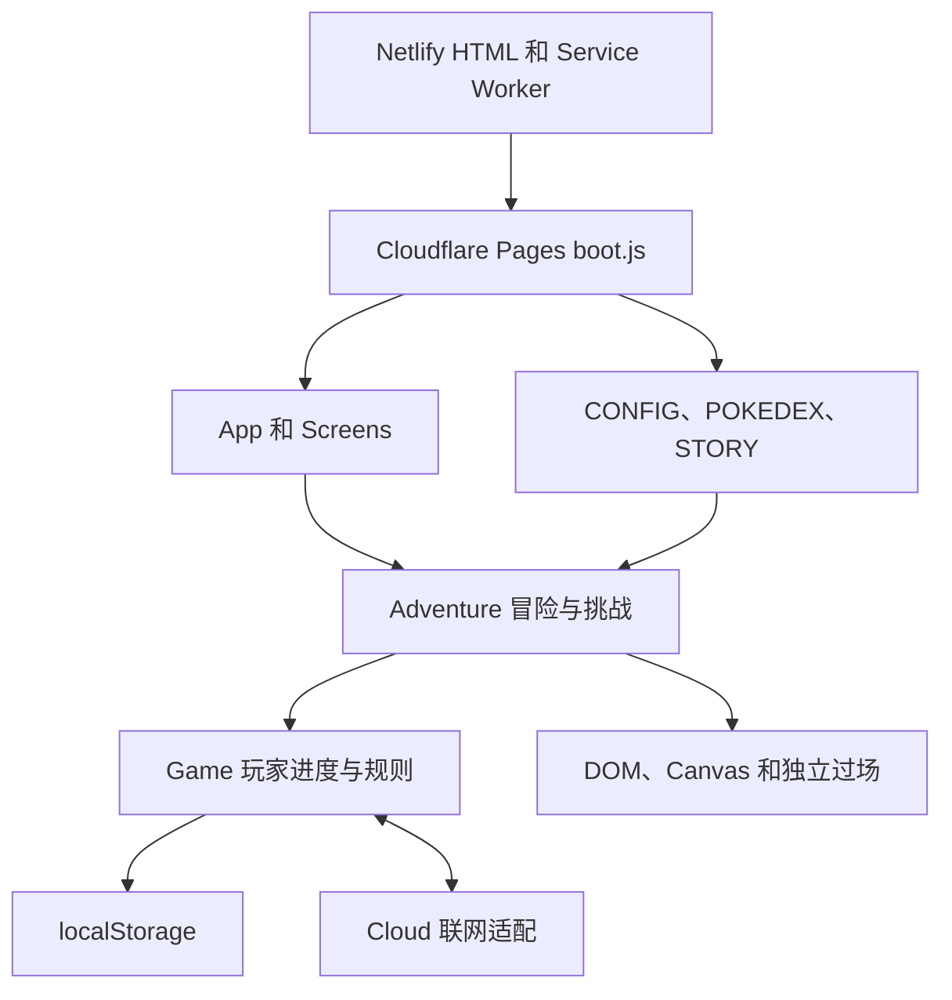

# Poke’Catch 前端实现深查

2026-11-04 · [架构总览](PokeCatch-architecture-research.md) · [数码宝贝版 PRD](../digimon-prd/PRD.md)

本次对照公开的 `b095b65025` 构建。Chrome 标签列表中发现原站，但页面快照读取超时。以下界面文字与行为来自公开包和作者说明，未在用户存档内逐项实玩。压缩包里重复出现的短函数名须以公开导出名定位。

## 入口、界面和运行层

| 定位符号 | 已确认的职责 | 复刻时要核对的行为 |
| --- | --- | --- |
| `boot.js` | 提供页面骨架并引用主 JS、CSS、Supabase vendor 和按语言加载的脚本。Netlify 的入口保留浏览器存档所在的站点来源。 | 本地站点打开即能运行，语言与设置的加载不会阻断游戏。 |
| `App.show`、`Screens.*` | 冒险、地图、队伍、图鉴、商店、寄养和后期玩法有各自的界面入口。部分界面公开 `init`、`enter`、`render` 或 `openCard`。 | 页面切换、详情关闭、手机长按、空态和锁定态。单凭接口无法确认实际布局。 |
| `Game.S`、`Game.DEX`、`Game.PREVO` | 玩家存档状态、物种数据索引、前置进化索引各有入口。规则层提供等级、经验、能力值、招式、物品和队伍查询。 | 同一物种可以拥有多个独立个体。切换界面后数据仍一致。 |
| `Adventure` | 有 `buildChapter`、`setChapter`、`step`、`tick` 及突袭、传说区域、战斗塔入口。 | 地图导航、回合推进、画面反馈与解锁各由哪一步触发。 |

## 冒险、捕获和成长

1. **从内容到遭遇。** `STORY.CHAPTERS` 的章节含 `steps`，包里可见 `gym` 节点与徽章字段。冒险公开遭遇池、栖息地、道具概率及事件入口，说明路线不是一份只按胜场递增的列表。具体节点顺序及昼夜、天气权重待按路线对照。
2. **从战斗状态到出招。** `Game` 提供 `statsOf`、`bestMoveAgainst`、`moveAcc`、`movePower` 等查询，`Adventure` 提供 `effectiveness`、`aliveTeam`、`winChance` 和反制相关接口。作者也说明会按对手选招。实际出招优先级和每回合的随机顺序尚未完整确认。
3. **从战斗结算到捕获。** 已追踪的 `catchProb` 先读战斗捕获率覆盖项，其次处理传说或幻兽的默认特殊值，普通路径读取物种捕获率和全局倍率，再按捕获增益和上限计算。`chooseBall` 可按物种档次选球，捕获设置还区分新物种、缺少和异色目标。`tryCapture` 内部有构造 `uid`、物种 `id`、等级、经验和异色状态并交给 `Game.receive` 的分支。普通捕获、特殊捕获、重复捕获和球消耗需分别对照。
4. **从个体到成长界面。** `Game` 有等级上限、经验、学习招式及进化相关接口。商店代码中，部分商品按徽章条件开放，经验糖果价格受地区经济参数影响。验证时分别记录数值变化、详情提示及奖励写入时点。

## 队伍与图鉴的可见规则

| 场景 | 公开代码能确认的行为 | 单机复刻验收 |
| --- | --- | --- |
| 编队 | 队伍说明允许最多 6 只，只有参战队伍获战斗经验。仓库帮助文案说明无容量上限，界面用 `VGrid` 呈现仓库。 | 6 槽满队时继续捕获，仓库出现新个体。用较长列表验证排序、滚动和选中。 |
| 冒险中换队 | `Screens.team` 帮助明确说明队伍与仓库可拖动交换，在路上要到下一个治疗中心才生效。作者另有手机长按说明。 | 拖拽后当前战斗队列保持，进入治疗中心后启用新队。手机长按实际手感待验证。 |
| 预设 | 队伍帮助提到 5 个预设槽、点击载入、加号新建，以及当前预设随变更更新。 | 建立两个预设，切换并重开页面，核实所选预设和个体归属。 |
| 图鉴 | `Screens.pokedex` 的帮助文案区分「当前持有」和曾捕获，交换最后一只会变为不再持有。还提到区域物种集齐后该区异色机会翻倍。 | 分别显示发现、登记与当前持有。进化后如何保留登记，以及本项目 Ver.1–5 的地区映射，仍需单独确认。 |

上述队伍及图鉴规则来自[游戏包](https://pokecatch-online.pages.dev/bundle/app.5f011bb067.js)，可搜索 `t.Screens.team=` 与 `t.Screens.pokedex=`。触屏反馈另见[作者发布帖](https://www.reddit.com/r/pokemonfr/comments/1x94jmr/pokecatch_besoin_de_vos_avis_jeu_navigateur/)。

## 保存和离线恢复

- **读档和迁移。** `Game.load` 从 `gachamon-save-v1` 读取 JSON，合并默认状态，再做版本迁移与字段整理。可见迁移将早期的球数量字段转入物品表。解析异常时回到默认状态。PRD 另要求损坏档提示，属于本项目的行为要求。
- **多标签页。** `TabLock` 通过本地键及 `storage` 事件识别其他标签页成为持有者，并调用失去持有权的回调。复刻需要明确重复打开时由谁推进与写档，避免同一场结算写两次。
- **恢复时钟。** 原站 `Clock` 有本地持久化时间，也可用公开 HTTP HEAD 响应时间校正。数码宝贝单机版需用本地时间规则承接这项职责。时间回拨、关页和重复打开要一起验证。
- **追赶过程。** 公开代码先检查时钟与队伍、按时间差和上限得到模拟时长，再调用 `Adventure.offline`，与 `holdSave`、`CatchUp.busy` 配合。能确认该构建配置的上限为 8 小时，另有离线经验、道具和升级上限参数。显示摘要前后的写档顺序、暂停状态与活动中的离线行为仍需对照。
- **联网切口。** `Cloud` 负责云档、好友、市场和排名等适配。其 `cloud_head`、`cloud_load`、`save_put` 只作为切分证据。单人突袭和塔的页面中也有联网记录，需要把本地挑战与成绩提交分开验收。

## Chrome 保存件实证

用户提供的 [本地保存页](reference-pages/Poke%27Catch.html) 保留了简中运行态 HTML。保存时冒险面板处于激活状态，画面对应关都第 2 章、4 号道路的治疗中心附近。配套目录有原版 CSS、四个以 `.下载` 为后缀的脚本和部分当时使用的图片。保存页也带有浏览器扩展引用与玩家状态片段，作为本地取证材料保存在发布目录之外。此次直接解析 HTML，未执行保存件脚本。

| 区域 | 保存件中可确认的结构 |
| --- | --- |
| 顶栏 | 训练师入口、图鉴进度、新内容提示、货币和资源、保存与设置。在线人数等联网内容按 PRD 范围排除。 |
| 冒险 | 章节、建议等级与进度位于场景上方。`#arena` 下有己方、训练家、敌方、天气 Canvas、敌方 HUD、增益、场景栏、六行队伍栏、特效层、横幅、战斗日志与速度控制。场景外还有消耗品、背包和「此处出没」面板。 |
| 队伍和仓库 | 预设栏、队伍槽、搜索、异色、属性、地区、可进化筛选。排序包括最近、图鉴编号、名字、等级、稀有度、能力和自定义，另有方向按钮。 |
| 图鉴 | 总完成度、分区进度、最近捕获、搜索和筛选。状态选项包括全部、已拥有、不再拥有、已见过和未收集。 |
| 培育屋与商店 | 培育屋分寄放和孵化器。保存件的帮助文字标出离线上限 8 小时、孵化需 4 小时、准备好后点击领取。商店文字确认徽章和首次拾取可分别解锁商品。 |

**速度档位有一处差异。** 保存态的三个实际按钮文本是 **×1、×2、×3**，此前主包配置中找到的是 `SPEEDS:[1,2,4]`。PRD 以保存态作为显示基线，内部倍率、是否存在条件切换及其他版本表现仍待实玩核实。HTML 同时含隐藏面板和空态模板，文本出现在保存件中并不表示当时可见。Canvas 像素、弹窗动效和触屏手势仍需截图或录屏对照。

## 对照清单与证据缺口

| PRD 范围 | 实现前补齐的证据 |
| --- | --- |
| FR-01/02 | 截取标题页、新建档、主场景、导航与弹窗的桌面和手机样本。记录每个入口的空态、禁用态和返回落点。 |
| FR-03/04 | 用新档走一次开场、普通遭遇、战败恢复、捕获和满队入仓。对照速度切换、是否可暂停、中心前后的换队时点。 |
| FR-05/06 | 对照详情页进化按钮、道具不足、成功反馈、图鉴变更和徽章解锁。物种进化关系以项目的第一世代资料为准。 |
| FR-07/08 | 记录商店、寄养、NPC 交换、单人突袭、塔、地下与赌场的入口、开放条件和结算。公开模块名证明有相应前端入口线索，不能据此确认全部模式当前可玩。 |
| FR-09/NFR-01 | 核对原作离线摘要和本地继续流程。项目单独验收重复刷新、多标签、时间回拨和仅托管 `site/` 的运行。 |

代码出处：[原站入口](https://pokecatch-online.netlify.app/) · [启动包](https://pokecatch-online.pages.dev/boot.js) · [游戏包](https://pokecatch-online.pages.dev/bundle/app.5f011bb067.js) · [样式包](https://pokecatch-online.pages.dev/bundle/app.f8b2479bdb.css)
